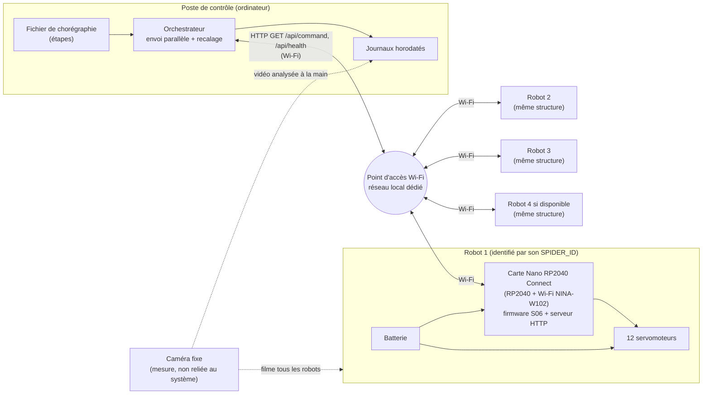

# Schéma système — éléments et interconnexions

> **Statut** : brouillon v0.1 — à valider par l'équipe
> **Dernière mise à jour** : 2026-11-17
> **Légende** : `[FAIT]` vérifié et sourcé · `[HYPOTHÈSE]` raisonnement non vérifié · `[À VÉRIFIER]` plausible mais non confirmé
> **Citations** : `[@ID, localisation]`, clés définies dans `docs/sources.bib`

Schéma demandé par les tuteurs : les éléments du système et leurs interconnexions [@S28]. Il reflète les
décisions des ADR-002 (architecture centralisée avec recalage), ADR-003 (Wi-Fi + HTTP) et ADR-004 (mesure
par vidéo).

## 1. Schéma

## 2. Éléments

| Élément | Rôle | Ce qu'on sait | Source / statut |
|---|---|---|---|
| **Poste de contrôle** | Lit la chorégraphie, envoie les ordres à tous les robots en parallèle, attend leur disponibilité, enregistre les journaux | Basé sur le superviseur S07 (Flask) et la CLI S08 | [@S07 ; @S08] ; ADR-002, ADR-005 |
| **Fichier de chorégraphie** | Suite d'étapes (une commande par robot au plus) | Format proposé en ADR-005 | ADR-005 `[HYPOTHÈSE]` |
| **Point d'accès Wi-Fi** | Réseau local commun à l'ordinateur et aux robots | Certains réseaux isolent les appareils : prévoir un point d'accès à nous | [@S03, §9.2] ; matériel `[À VÉRIFIER]` |
| **Robot (×3 ou 4)** | Exécute les ordres reçus | 4 pattes × 3 servomoteurs = 12 servomoteurs | [@S04, ch. 1 p. 7] |
| **Carte du robot** | Reçoit les ordres en Wi-Fi, pilote les servomoteurs | Arduino Nano RP2040 Connect déclarée par l'équipe ; module Wi-Fi NINA-W102 ; firmware S06 | Déclaré par l'équipe `[À VÉRIFIER sur chaque robot]` ; [@S06, wifi.h l. 3-6] |
| **Servomoteurs** | Mouvement des pattes | 12 par robot ; plage min/max propre à chaque robot | [@S05, ex. 3 p. 22] |
| **Alimentation** | Batterie du robot | Version d'origine : 2 piles Li-Ion (2 × 3,7 V) via la carte mère ; version de l'an dernier : batterie Li-Ion 2S avec modules abaisseurs | [@S04, ch. 1 p. 7 ; @S03, §3.2] ; version de nos robots `[À VÉRIFIER]` |
| **Caméra** | Filme tous les robots ensemble pour mesurer la synchronisation | Non reliée au système ; cadence `[À VÉRIFIER]` | ADR-004 |

## 3. Interconnexions

| Liaison | Entre | Nature | Remarque |
|---|---|---|---|
| Ordres et état | Poste de contrôle ↔ robots, via le point d'accès | HTTP en Wi-Fi : `GET /api/command?cmd=…&n=…` et `GET /api/health` | Port et format à confirmer par test (ADR-003) ; réponse envoyée avant l'exécution [@S06, wifi.cpp l. 98-124 et 115-123] |
| Programmation du robot | Ordinateur → robot, par câble USB | Téléversement du firmware, **robot éteint** | [@S04, ch. 1 p. 7] ; règle de sécurité |
| Commande des servomoteurs | Carte du robot → servomoteurs | Signaux de commande, avec écrêtage min/max | [@S06, motors.h l. 82-101] |
| Alimentation | Batterie → carte et servomoteurs | Selon la version électronique | `[À VÉRIFIER]` |
| Mesure | Caméra → vidéo → analyse manuelle | Aucune liaison électronique avec le système | ADR-004 |

## 4. Ce que le schéma ne montre pas encore

- Le nombre exact de robots et la version électronique de chacun `[À VÉRIFIER]`.
- Le matériel du réseau (point d'accès) et de la caméra `[À VÉRIFIER]`.
- Les adresses et identifiants : ils restent dans un fichier local, jamais dans le dépôt public.

## Sources

- [@S03, §3.2 et §9.2] ; [@S04, ch. 1 p. 7] ; [@S05, ex. 3 p. 22] ; [@S06] ; [@S07] ; [@S08] ; [@S28].
- ADR-002, ADR-003, ADR-004, ADR-005.
